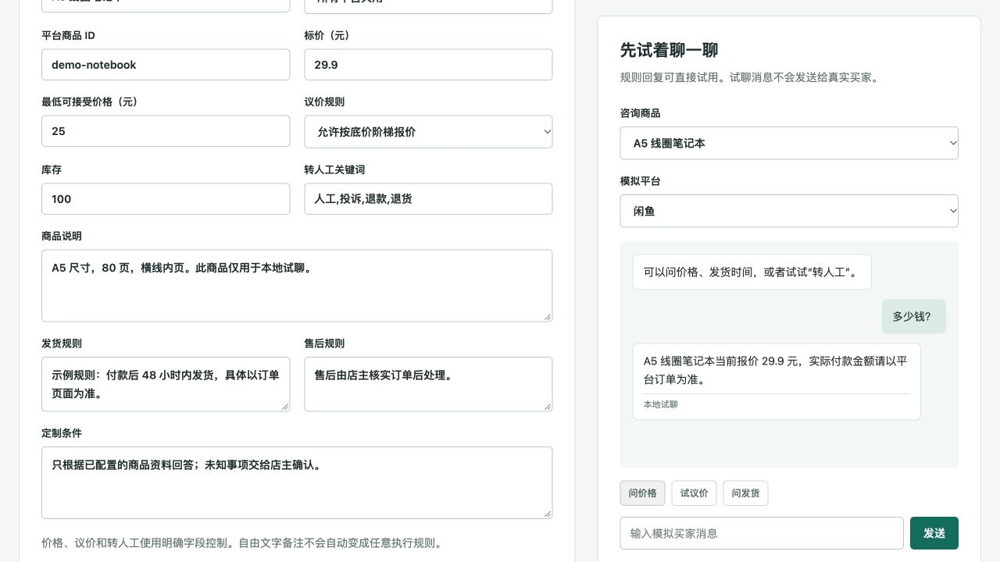
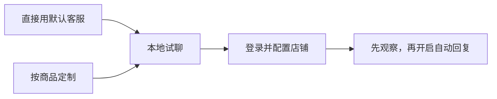

# 店小助 · 电商自动回复客服

**不想从零写客服话术，先用默认的。**

店小助是给电商店铺用的自动回复工具。系统自带一套接待话术，不用先配商品，也不用填 AI 密钥，打开工作台就能试聊。连接店铺后，它可以回应问候、引导买家查看商品或订单信息，把需要店主确认的问题记入待处理列表。

**想让回复更自然，可以再接上 AI。** 在工作台填接口地址、模型和密钥，点一下测试，再保存就行，不用改配置文件。同样使用默认客服，不用另外定制机器人：没配置 AI 就用内置话术，配置后由 AI 根据买家的提问组织表达。连接失败或回复未通过检查时，自动用回内置话术。

想让它回答得更具体，再切换到“按商品定制”：每件商品卖多少钱、最低接受多少、什么时候发货，都由你设置。先用起来，再按生意需要慢慢补充。

[能帮你做什么](#advantages) · [看界面和回复](#demo) · [下载安装](#quickstart) · [连接店铺](#connect) · [支持哪些平台](#platforms) · [详细教程](docs/PLATFORM_SETUP.md)

> 闲鱼、淘宝、京东已完成真实店铺消息收发测试（作者于 2026-11-03 确认）。拼多多、抖店、快手小店、小红书千帆已写好接入代码，通过本地测试，仍待真实店铺测试。

## 两种用法，按你的需要选

| | 直接用默认客服 | 按商品定制 |
| --- | --- | --- |
| 适合谁 | 想先接待咨询，暂时不想整理商品资料的商家 | 希望机器人介绍商品、报价、按底价还价的商家 |
| 要填什么 | 不用填商品或写话术 | 商品资料、价格、常见问答等 |
| 怎么回答 | 内置话术直接用，也可接入 AI 改善表达；询价、库存、发货引导查看商品或订单页面 | 使用你填写的商品资料；不同商品、不同平台可以分别设置 |
| 遇到复杂问题 | 记入人工待办，暂停这段聊天，交给店主 | 同样支持人工接管 |

**默认客服免的是话术和商品配置，连接店铺仍需登录账号、设置平台。** 它不会自动读取商品页面，也不会在没资料时承诺价格、库存或发货日期。切换两种用法时，已有的商品资料会保留。

<a id="advantages"></a>

## 能帮你做什么

| 你想省下的事 | 店小助怎么做 |
| --- | --- |
| **不想从头写一套客服话术** | 默认接待话术已经备好，先试聊，再连接自己的店铺。 |
| **想接 AI，又不想折腾配置文件** | 工作台直接填写接口地址、模型和密钥，先测试再保存；后续回复自动使用新设置，不用重启。 |
| **同样的问题，一天回答很多遍** | 按商品填好介绍、常见问答和发货说明，机器人按这些资料回复。 |
| **商品多，价格和话术容易弄混** | 每件商品单独设置；同一商品在不同平台，也能用不同的价格和说明。 |
| **买家一直还价，还得反复谈** | 你设标价和底价，它按规则逐步报价，不低于底价；不接受还价的商品也能单独设置。 |
| **简单问题能自动回，售后还是想自己处理** | 退款、投诉和答不上来的问题记入待处理列表，暂停这段聊天，处理后可恢复自动回复。 |
| **想先看看它会怎么回答** | 在工作台里模拟买家提问，试价格、还价、发货等问题。这些试聊不会发给真实买家。 |

不配置 AI，两种用法都能正常使用。接入后，默认客服会用 AI 组织更自然的表达；商品定制模式继续用 AI 辅助识别问题，按已填资料回答。AI 不会替你补齐未知价格、库存或发货日期。[如何开启可选 AI](docs/PLATFORM_SETUP.md#可选让默认客服说得更自然)。

<a id="demo"></a>

## 先试试看它怎么回答

选择“直接用默认客服”，不用填写商品，就可以在右侧提问：

| 买家问 | 默认客服怎么处理 |
| --- | --- |
| “在吗？” | 打招呼，问买家想了解哪件商品。 |
| “多少钱？” | 提醒价格以商品页面为准，不凭空报价。 |
| “什么时候发货？” | 引导查看商品或订单页面，不承诺具体日期。 |
| “我要退款” | 记入人工待处理列表，暂停这段聊天。 |

需要具体报价和商品介绍时，切换到“按商品定制”。下面是公开示例商品的本地试聊界面：



### 比如，你卖一本笔记本

填好：**A5 线圈笔记本，29.9 元，最低 25 元，80 页，付款后 48 小时内发货。** 再把“有多少页”及对应答案写进常见问答。

| 买家问 | 机器人怎么处理 |
| --- | --- |
| “多少钱？” | 回复“当前报价 29.9 元，实际付款金额请以平台订单为准”。 |
| “有多少页？” | 回复“这款笔记本有 80 页横线内页”。 |
| “可以便宜点吗？” | 按设置逐步报价，最低到 25 元。你也可以把这件商品设为不议价。 |
| “什么时候发货？” | 回复你填写的发货说明。 |
| “我要退款” | 暂停自动回复，加入工作台的人工待处理列表，由你查看处理。 |

这是按公开示例配置验证过的处理方式。聊天里的报价不会自动修改订单价格，人工待处理列表也不会自动分派平台客服。

### 使用顺序



默认客服可直接试聊；想要具体商品回复，再填表保存。首次连接店铺还需要登录账号、设置聊天页面，具体步骤见下方教程。

<a id="quickstart"></a>

## 第一次用，先在电脑上试一试

### 1. 下载与首次安装

准备 **Python 3.11 或以上版本**。在 GitHub 点击 **Code → Download ZIP**，解压后进入项目文件夹；也可以使用下方命令下载。

**macOS / Linux**：在项目文件夹中打开终端，首次运行：

```bash
bash setup.sh
bash start.command
```

**Windows**：先双击 `setup.bat`，安装完成后双击 `start.bat`。

安装脚本会创建独立 Python 环境、安装依赖和 Chromium。安装通常只需做一次，日常使用直接运行启动脚本即可。macOS 若希望双击启动，可先执行 `chmod +x start.command`；使用 `bash start.command` 不需要额外设置执行权限。

<details>
<summary>开发者：使用 Git 下载或手动安装</summary>

```bash
git clone https://github.com/yelinyuan798-commits/UniversalECommerceBot.git
cd UniversalECommerceBot
python3 -m venv .venv
.venv/bin/python -m pip install -r requirements.txt
.venv/bin/python -m playwright install chromium
.venv/bin/python main.py console
```

以上虚拟环境路径适用于 macOS / Linux；Windows 推荐使用仓库提供的安装与启动脚本。

</details>

### 2. 打开工作台，先聊一聊

浏览器打开 **<http://127.0.0.1:8765>**。首次使用默认选中 **“直接用默认客服”**，在右侧点击 **“打招呼” “问价格” “问发货”**，就能查看系统自带的回复。已有商品配置的用户继续使用原来的定制模式。

这一阶段无需 AI 密钥，也无需商家账号。试聊记录与实际店铺记录分开，不会发送给真实买家。

想试 AI 回复，打开 **“AI 设置” → 填接口地址、模型和密钥 → 测试连接 → 启用并保存**，然后回到这里试聊，不用重启。[查看填写说明](docs/PLATFORM_SETUP.md#可选让默认客服说得更自然)。默认客服仍不用填商品；退款、投诉和需要店主确认的问题继续进入人工待办。

### 3. 需要更具体的回复，再填商品

默认客服不要求填写商品。想让机器人介绍商品、报出具体价格时，在 **“商品与规则”** 选择 **“按商品定制”**，填写资料，再点击 **“一键生成并保存配置”**。

| 填写内容 | 用途 |
| --- | --- |
| 商品名称、所属平台、平台商品 ID | 将咨询与正确商品对应起来；商品 ID 需自行填写 |
| 标价、最低可接受价格、议价规则 | 控制报价；单个商品是否议价请使用该商品的议价选项 |
| 商品说明、库存、发货与售后规则 | 明确机器人可以回答的商品事实 |
| 常见问答 | 每行填写 `问题 \| 答案`，例如 `有多少页 \| 一共 80 页，横线内页。` |
| 转人工关键词 | 设置需要店主处理的咨询，例如人工、投诉、退款 |

价格、是否还价、转人工关键词，都填在对应的位置。“定制条件”可以补充说明，但不能靠一句话让机器人自动退款、改订单或执行其他操作。

**添加多个商品**：更换“商品所属平台＋平台商品 ID”并保存，会添加新商品；相同组合则更新已有商品。右侧“咨询商品”可切换试聊对象，批量维护可用“多商品 / 精细编辑”。

试聊时多问几遍价格、还价和售后问题。回复符合你的要求后，再连接店铺。

<a id="connect"></a>

## 连接店铺，开始回复买家

先准备商家账号和一个测试买家账号。首次接入网页平台时，需要设置程序从哪里读取消息、向哪里发送回复；这部分要按当前店铺页面配置，通常需要懂网页调试的人协助。具体做法见 [连接店铺教程](docs/PLATFORM_SETUP.md)。

| 步骤 | 怎么操作 | 看什么 |
| --- | --- | --- |
| **① 选好回复方式** | 选择“直接用默认客服”；或选择“按商品定制”并保存资料 | 默认接待无需商品；定制时核对平台、商品 ID、价格和服务规则 |
| **② 连接平台** | 在“平台接入”启用目标平台，填写接入配置并“保存接入配置”；保持 `dry_run: true` | 在本机登录，确认程序读到的是正确的聊天和消息 |
| **③ 先看回复，不发送** | 点击“开始观察”，让测试买家发送一条新咨询 | 检查买家、商品和准备回复的内容；此时不发送 |
| **④ 开启发送** | 点击“停止” → 将目标平台的 `dry_run` 改为 `false` → “保存接入配置” → “开启自动回复” | 让测试买家再发一条**新消息**，在买家端确认只收到一次正确回复 |
| **⑤ 平时怎么用** | 在“消息与人工接管”查看记录；处理人工待办后点“恢复自动回复” | 查看哪些回复已发出，处理售后和待确认的消息 |

观察期间已经看过的消息不会在切换后补发。切换回复方式、修改商品或连接设置前，请先停止机器人。电脑和程序需要保持运行；暂停所有接待时点击“停止”。

<a id="platforms"></a>

## 目前支持哪些平台

| 平台 | 当前接入方式 | 验证状态 |
| --- | --- | --- |
| 闲鱼 | WebSocket 消息连接 | **真实店铺收发已跑通** · 作者实测确认 |
| 淘宝 / 千牛 | 商家网页工作台 | **真实店铺收发已跑通** · 作者实测确认 |
| 京东 / 咚咚 | 商家网页工作台 | **真实店铺收发已跑通** · 作者实测确认 |
| 拼多多 | 商家网页适配器 | 本地集成测试通过，待实店验证 |
| 抖音 / 抖店 | 商家网页适配器 | 本地集成测试通过，待实店验证 |
| 快手小店 | 商家网页适配器 | 本地集成测试通过，待实店验证 |
| 小红书 / 千帆 | 商家网页适配器 | 本地集成测试通过，待实店验证 |

闲鱼、淘宝、京东的结果来自作者于 **2026-11-03** 的实店确认；其余四个平台暂未完成实店测试。换一家店铺后，仍需配置并检查收发是否正常。项目目前通过电脑上的网页工作台或消息协议连接平台，不直接操作手机 App。详细设置见 [接入指南](docs/PLATFORM_SETUP.md)。

## 已做过的测试，还有哪些事需要你处理

**2026-11-04 代码版本：本地 197 项测试、251 个子测试通过。GitHub 的 Python 3.11 / 3.13 检查结果见对应提交。** [查看验证记录](docs/TEST_REPORT.md) · [查看云端测试](https://github.com/yelinyuan798-commits/UniversalECommerceBot/actions)

测试覆盖商品规则、底价与不议价、跨平台隔离、人工接管、重复消息、发送确认、模型失败，以及真实 Chromium 驱动本地合成商家页面的收发流程。本地合成页面测试与真实店铺验证分别记录。

默认模式用于通用接待；按商品定制后可处理商品介绍、报价和已配置问答。核实付款、发货、退款、改订单价格、同步实时库存，仍要由你在平台上处理。页面改版或登录失效时需要重新检查连接；发送结果不明确的消息会留给你核实，不自动重复发送。

<details>
<summary>开发者：测试、命令行与目录说明</summary>

```bash
.venv/bin/python -m pip install -r requirements-dev.txt
.venv/bin/python -m playwright install chromium
.venv/bin/python -m pytest -q
.venv/bin/python main.py doctor       # 检查配置，不验证真实店铺收发
.venv/bin/python main.py run          # 观察已启用平台
.venv/bin/python main.py run --live   # 仅 dry_run=false 的平台允许发送
```

| 路径 | 职责 |
| --- | --- |
| `core/profiles.py` / `core/default_skill.py` / `core/default_ai.py` | 默认接待话术、可选 AI 表达、回复模式和商品配置 |
| `core/ai_settings.py` | 本机 AI 配置保存、连接测试与每次请求的配置快照 |
| `core/service.py` / `core/store.py` | 回复规则、人工接管与持久化状态 |
| `core/runtime.py` / `core/platform_catalog.py` | 平台目录及启动、停止 |
| `platforms/browser.py` | 可配置的网页收发适配器 |
| `platforms/xianyu/` | 闲鱼消息协议实现 |
| `web/` | 本地商家工作台 |
| `tests/` | 规则与浏览器集成测试 |

新增平台可复用商品规则和消息状态管理，再实现相应的收发适配。旧 `core/agent.py`、`core/context.py` 与 `config/delivery_items.json` 不由新入口使用。

</details>

<details>
<summary>本地文件和可选 AI 配置在哪里？</summary>

- `config/merchant.json`：回复模式与自己的商品规则。没有此文件时使用默认客服；旧配置未指定模式时继续按商品回复。
- `config/platforms.local.json`：本机平台配置；升级时保留已有平台设置，并补充新增平台的默认关闭条目。
- `config/ai.local.json`：在工作台保存的 AI 设置与密钥，优先于旧环境配置；仅本机当前用户可读写。
- `config/.env`：兼容旧 AI 配置，以及闲鱼 `COOKIES_STR`。未保存工作台 AI 设置时才读取其中的模型配置。
- `data/`：浏览器登录资料、会话及发送记录。Chromium 程序由 Playwright 安装到其浏览器缓存目录。

以上私有资料已加入 Git 忽略规则，请只在本机维护。工作台默认仅监听本机。启用外部模型时，默认模式只发送本次买家提问及对应的通用接待规则，不发送保留的商品资料或旧会话；商品定制模式会发送相关咨询和必要的商品资料。默认接待 Skill 是内置规则和话术，AI 仅改善普通接待的表达；不需要单独安装 Codex Skill。条件生成器本身是本地结构化解析。

</details>
